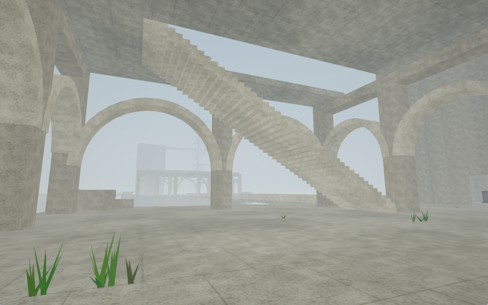
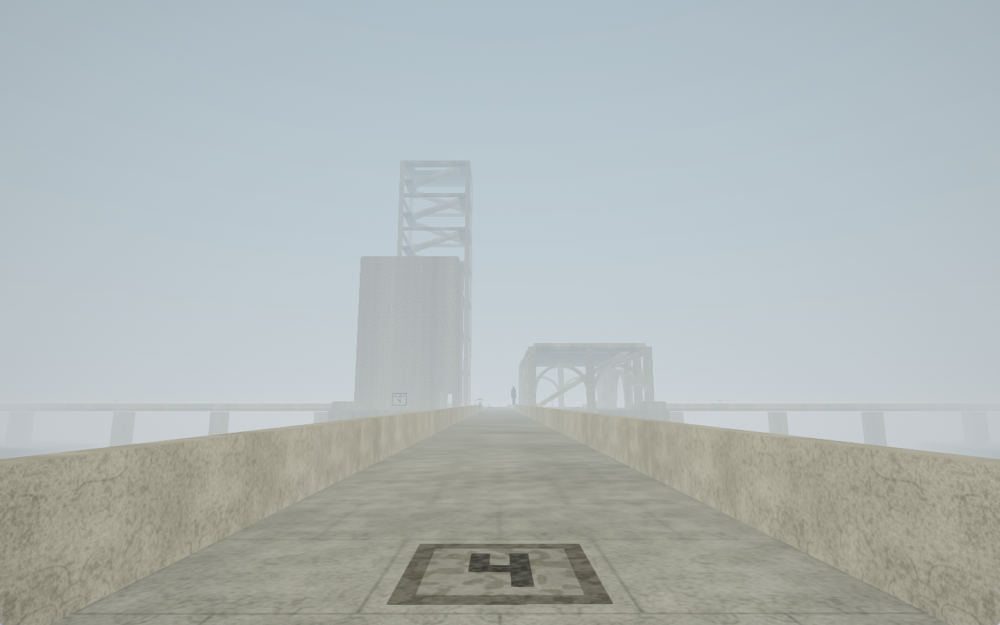
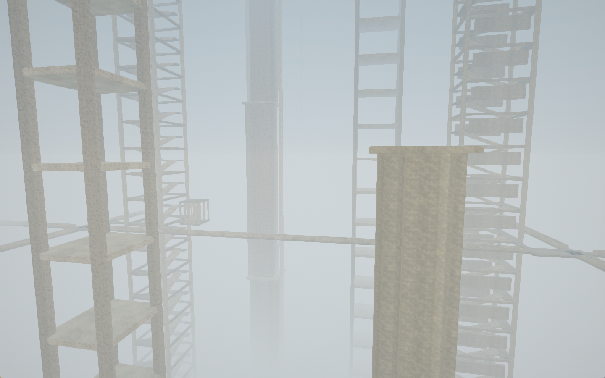
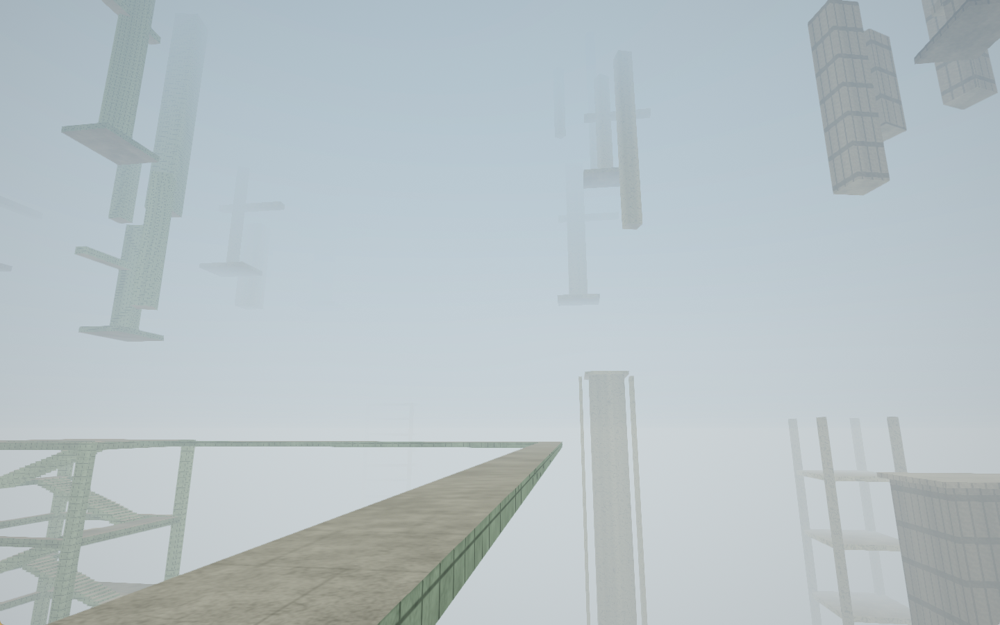
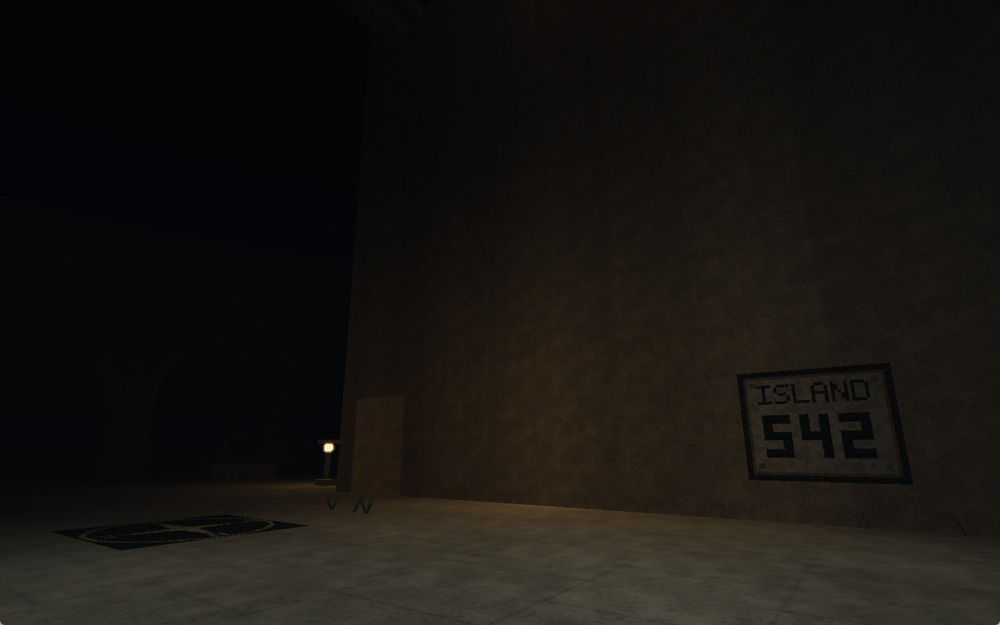

# CAERO

**The Silent Archipelago — Version 1.0**



霧に包まれた海の上に、石造りの島々がどこまでも続いています。
この幻想世界を探索し、謎を解き、脱出への道を見つけてください。

CAERO は、一人称視点（FPS）で幻想世界を巡り、素数を中心とした数学の謎に挑む、ひとり用の高難度な謎解き脱出ゲームです。
島々を歩き、出会った人の言葉に耳を傾け、気になるものを調べながら、脱出につながる手がかりを探していきます。

## プレイヤー向けガイド

### 探索し、謎を解き、脱出する

海に囲まれた島には、石の建物や塔、回廊が連なっています。橋を渡り、階段を上り、周囲をよく観察してみてください。
探索に合わせて新しい島々が生成され、一度訪れた場所に戻ると、同じ風景が待っています。

人との会話や、調べたものから得られる情報を手がかりに、この世界の謎を考えていきます。
探索で見つけたことと数学の知識をつなぎ合わせ、脱出への道を探すことが、このゲームの目的です。

昼から夕暮れ、そして夜へ。移り変わる光と灯籠の明かり、昼夜に合わせた音楽が、幻想世界の空気を描きます。
ときには足を止めて景色を眺めながら、自分のペースで謎に向き合ってください。

### スクリーンショット

| 霧の向こうへ続く橋 | 高い塔をつなぐ通路 |
| --- | --- |
|  |  |
| **空中に浮かぶ構造物** | **灯籠が照らす夜の島** |
|  |  |

### 難易度と、Web検索・AIの活用について

謎解きの中心は、数学の**素数に関する問題**です。
数学に深く取り組んでいる方でも、じっくり考えてようやく解けるほどの、非常に高い難易度を意図しています。

**難しすぎると感じたら、迷わずWeb検索を使ってください。必要であれば、AIにも頼ってください。**
知らないことを調べ、考え方のヒントを求め、得られた情報を手がかりに考えを進めることも、このゲームで想定している遊び方です。
Web検索やAIの活用は歓迎します。それらの力も借りながら、謎に挑み、脱出を目指してください。

### 動作環境

| 項目 | 内容 |
| --- | --- |
| OS | Windows 10 / 11（64bit） |
| 描画 | OpenGL 3.3 以上に対応した GPU・ドライバー |
| 入力 | キーボードとマウス |
| 言語 | 日本語 |
| プレイ人数 | 1人 |

配布版には .NET の実行に必要なファイルを同梱しています。.NET SDK のインストールは不要です。
日本語の表示には、Windows の游ゴシック・メイリオ・MS ゴシックのいずれかを使用します。

### はじめかた

1. 配布 ZIP をフォルダーごと展開します。
2. 展開した `CAERO` フォルダー内の `StartGame.bat` をダブルクリックします。
3. タイトルで「はじめから（ゲームスタート）」を選ぶと探索が始まります。続きから遊ぶときは「コンテニュー」を選んでください。

`StartGame.bat` と `bin` フォルダーは、同じフォルダーに置いたまま使用してください。`bin` 内の `CAERO.exe` からも起動できます。

### 基本操作

| キー・入力 | 動作 |
| --- | --- |
| W / A / S / D | 移動 |
| マウス | 視点を動かす |
| Shift | 高速移動 |
| Space | ジャンプ・遊泳中の上昇 |
| E | 話す・調べる |
| Enter | ポーズ |
| Esc | マウスを解放する |
| 左クリック | 解放したマウスをゲーム操作に戻す |
| Alt + Enter | ウィンドウ表示・全画面表示の切り替え |

人や調べたいものに近づいて、その方向を向くと、操作の案内が表示されます。
海では泳ぐこともできます。陸へ戻るときは、水面下へ続く階段を探してください。
操作はタイトル画面やポーズメニューの「操作方法」でも確認できます。

**メッセージ表示中**は E / Space / Enter で全文表示・次のページ・決定、Esc で閉じます。
選択肢は矢印キーまたは W / A / S / D で選びます。

**メニュー**は ↑ / ↓ または W / S で選択、Enter で決定します。マウスでも操作できます。

### セーブと終了

プレイ状況は約10秒ごとに自動保存され、ポーズ時やタイトルへ戻るとき、終了時にも保存されます。
再開にはタイトルの「コンテニュー」を使います。セーブデータがない場合は選択できません。

**セーブデータは1つです。「はじめから（ゲームスタート）」を選ぶと、現在のデータが上書きされます。**

配布版のセーブファイルは `bin/generated-view.json` です。バックアップする場合はゲームを終了してからコピーしてください。
ゲームを別の場所へ移すときは、セーブを含むフォルダー全体を移動してください。

終了するときは Enter でポーズし、「タイトルへもどる」からタイトル画面の「終了」を選びます。

## 技術的な説明

### 開発環境と構成

C# / .NET 8 と Raylib-cs 7.0.2（ネイティブ raylib 5.5）で実装しています。
描画には OpenGL / GLSL を使用し、ワールド生成、移動・当たり判定、会話、音声、保存をゲーム側で組み立てています。

| パス | 内容 |
| --- | --- |
| `src/CAERO.sln` | Visual Studio 用ソリューション |
| `src/CAERO/` | ゲーム本体の C# ソースとプロジェクト |
| `src/CAERO/Shaders/` | ワールド・空・ポストエフェクト用シェーダー |
| `src/CAERO/Content/` | 画像と日本語テキストの編集用データ |
| `src/CAERO/Music/` | 昼夜の BGM |
| `tools/ContentPacker/` | 配布用コンテンツのパッケージ化ツール |
| `doc/` | 配布 ZIP に含める説明書と起動用バッチ |
| `Release.ps1` | ビルド・コンテンツのパッケージ化・ZIP 作成 |

### ワールド生成とストリーミング

ワールドは192単位四方の区画で管理します。建築や小物は共通の形状部品と配置規則から手続き的に生成し、足場や歩行経路、構造物との重なりを確認して配置します。

島の整数座標から SHA-512 の先頭128bitを取り出し、ワールドシードと用途別の値を組み合わせた乱数の種を作ります。
生成用の乱数には独自の xor128 を使用し、同じ生成仕様・シード・座標から同じ島を再現します。

起動時は周囲5×5区画を準備します。移動中はバックグラウンドで次の区画を計算し、完成した区画を毎フレーム最大1つ描画へ追加します。
保持する範囲は現在地の周囲、最大7×7の49区画です。遠い区画の描画モデルや当たり判定を解放し、再訪時に再生成することで、移動距離に比例して全マップをメモリへ蓄積することを避けています。

島の住所は符号付き64bit整数、島内の位置はローカル座標で管理します。
島を移るたびに描画・物理の原点を現在地へ移す Floating Origin 方式で、遠方での浮動小数点精度の低下を抑えています。

### 描画・音声・データ

- **描画**：手続き生成したメッシュと材質表現に、霧、昼夜の光、灯籠の明かり、水面・水中表現、ポストエフェクトを組み合わせています。
- **音声**：足音や水音などの効果音・水中環境音は起動時に波形とノイズから合成します。BGM は同梱のオリジナル MP3 を再生し、昼夜に合わせて切り替えます。
- **テキストと画像**：開発時は `Content/` の JSON・PNG を読み込みます。配布時は `Content.dat` にまとめ、実行時にメモリ上で読み込みます。
- **保存**：シード、位置・視点、進行状況、生成仕様と座標形式のバージョンを JSON に保存します。ゲームのバージョン「1.0」と、セーブ内の生成仕様バージョンは別の値です。

### ソースからのビルドと実行

開発には **.NET 8 SDK** が必要です。初回の依存パッケージ復元には NuGet への接続が必要です。
以下のコマンドはすべてリポジトリのルートで実行します。

```powershell
dotnet build src/CAERO.sln -c Debug
dotnet run --project src/CAERO -c Debug
```

Visual Studio を使う場合は、Visual Studio 2022 17.8 以上で「.NET デスクトップ開発」を用意し、`src/CAERO.sln` を開いて実行します。

通常のワールドシードは `1701` です。別のシードで新規プレイを始める場合は、起動時に指定します。
コンテニューでは保存済みのシードが使われます。

```powershell
dotnet run --project src/CAERO -c Debug -- --seed=48291
```

音声を初期化せずに起動する場合は `--no-audio` を指定できます。

開発時のセーブ先は構成によって異なります。

| ビルド構成 | 保存先 |
| --- | --- |
| Debug | `src/SaveData/generated-view.json` |
| Release | 実行ファイルと同じフォルダーの `generated-view.json` |

セーブデータとクリア実績（`achievements.json`）は、Debug では整形したプレーンな JSON、Release では `CAERO-SAVE:1` の識別ヘッダーと JSON を Base64 化した本文で保存します。既存環境との互換性のためファイル名は維持します。Release の形式は手軽な直接編集を抑えるための難読化であり、暗号化ではありません。どちらの構成でも両方の形式を読み込み可能で、新たに書き込む際はビルド構成に応じた形式を使用します。

### 配布パッケージの作成

リポジトリのルートで、次を実行します。

```powershell
powershell -NoProfile -ExecutionPolicy Bypass -File .\Release.ps1
```

Windows x64 向けの自己完結型 Release ビルドを作成し、コンテンツのパッケージ化と配布用ファイルのコピーを行って、`out/CAERO.zip` に出力します。

```text
CAERO/
├─ StartGame.bat
├─ Readme.txt
└─ bin/
   ├─ CAERO.exe
   ├─ Content.dat
   ├─ Music/
   ├─ Shaders/
   └─ 実行に必要な DLL・その他のファイル
```

`Content.dat` はファイル名を含むコンテンツを AES-256-GCM で暗号化したパッケージです。
これは気軽な内容閲覧を抑えるためのもので、実行ファイルやメモリの解析に対する秘匿を保証するものではありません。
通常の `dotnet build` / `dotnet publish` ではパッケージ化しないため、配布 ZIP の作成には `Release.ps1` を使用します。

### 検証

ゲーム本体に、生成・移動・保存・UI などの自己テストと描画確認用の起動オプションを用意しています。

```powershell
# 生成・移動・ストリーミングなどの検証
dotnet run --project src/CAERO -c Debug -- --stream-test

# 上記に加えて、実際の描画・リサイズなどを確認（OpenGL 環境が必要）
dotnet run --project src/CAERO -c Debug -- --self-test
```

これらは開発用の検証コマンドです。通常のプレイには必要ありません。
